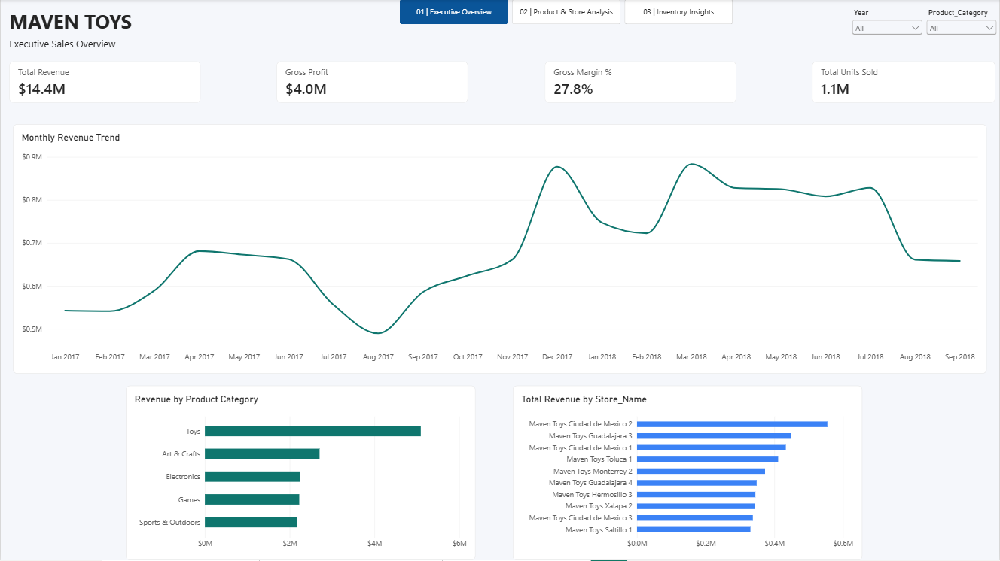

# Maven Toys | Descriptive, Predictive & Prescriptive Analytics

A five-page **Power BI Desktop** portfolio project for a **fictional toy retailer in Mexico**, combining historical sales and inventory reporting, experimental demand forecasting, and forecast-driven replenishment scenarios. Python generates the predictive and prescriptive tables; Power BI presents the results in an interactive semantic model.

> **Historical demonstration, not an operational tool.** The source transactions end on **2018-09-30**; the inventory table is treated as an **assumed 2018-10-01 snapshot**. Forecasts cover **2018-10-01 through 2018-10-28**. Supplier lead times, service targets, and purchase budgets are illustrative rather than observed business facts. Forecast validation is exploratory and the recommendations are simulated, not realized outcomes.



## From description to decisions

| Layer | Business question | Implementation |
|---|---|---|
| **Descriptive** | What happened? | Historical sales, revenue, gross profit, store/product performance, and recorded stock availability. |
| **Predictive** | What might happen next? | A 28-day store–product unit-sales forecast, derived revenue/profit estimates, and transparent model diagnostics. |
| **Prescriptive** | What could we do given the forecast? | Illustrative reorder quantities prioritized under three purchasing-budget and lead-time scenarios. |

The prescriptive layer **uses the same predictive forecast** rather than training a separate model.

## Report pages

| Page | Analytical focus | Screenshot |
|---|---|---|
| **1. Executive Overview** | Revenue, gross profit, gross margin, units sold, trends, top categories and stores | [View](screenshots/report_01-executive-overview.png) |
| **2. Product & Store Analysis** | Product/category profitability and differences across store-location types | [View](screenshots/report_02-product-store-analysis.png) |
| **3. Inventory Insights** | On-hand inventory at cost; recorded zero-stock and low-stock store–product combinations | [View](screenshots/report_03-inventory-insights.png) |
| **4. Predictive Analytics** | Forecast units, revenue and gross profit; category/store comparisons; model evaluation | [View](screenshots/report_04-predictive-analytics.png) |
| **5. Prescriptive Analytics** | Scenario selection, reorder quantities, budget allocation, and modeled shortage exposure | [View](screenshots/report_05-prescriptive-analytics.png) |

**Power BI model diagrams:** [Descriptive](screenshots/data-model_01-descriptive.png) · [Predictive](screenshots/data-model_02-predictive.png) · [Prescriptive](screenshots/data-model_03-prescriptive.png)

**Report files:** [Five-page PDF](Maven_Toys_Dashboard_v2.pdf) · [Power BI Desktop PBIX](Maven_Toys_Dashboard_v2.pbix)

## Dataset and model

The original Maven Analytics *Mexico Toy Sales* data is kept **unchanged** in `data/`.

| Original dataset | Records | Purpose |
|---|---:|---|
| `sales.csv` | 829,262 | Individual recorded sale lines, **2017-01-01 to 2018-09-30** |
| `products.csv` | 35 | Product names, categories, listed unit costs and prices |
| `stores.csv` | 50 | Store names, locations, cities and opening dates |
| `inventory.csv` | 1,593 | Recorded store–product on-hand quantities (single snapshot) |

**Descriptive model:** Calendar→Sales, Products→Sales, Stores→Sales, Products→Inventory, and Stores→Inventory; all documented as active, single-direction, one-to-many relationships.

**Extensions:** `Forecast_28D` connects to Products and Stores; `Replenishment_Recommendations` connects to Products, Stores, and `Scenario_Assumptions`. `Forecast_Backtest_Metrics` is disconnected because it contains *global model-level* evaluation scores. The 28-day forecast is one aggregate horizon per store–product pair, **not a daily forecast**; it should not be plotted as 28 daily predictions.

See [data dictionary](docs/data_dictionary.md) for every source/output field and [methodology](docs/methodology.md) for the relationship structure and analytical logic.

## Key results

### Descriptive

- Revenue displayed in the descriptive report: approximately **$14.44 million**, with **27.8%** gross margin. *Toys* is the leading category by revenue.
- Recorded inventory: **29,742 units** with approximately **$300,209.58** at listed product cost.
- **77 of 1,593** recorded inventory combinations have zero units (**4.83%**); **603** have 1–10 units. The **157 absent** combinations among 50 × 35 possible pairs are **not assumed to be stockouts**.

### Predictive — experimental

| Metric | Result |
|---|---:|
| Selected approach | `pooled_blend_50` |
| Six-window tuning WAPE, store–product level | **55.71%** |
| Previously viewed September 2018 holdout WAPE | **62.18%** |
| Same holdout: simple last-28-day baseline | **70.07%** |
| Forecast window | **2018-10-01 to 2018-10-28** |
| Forecast rows | **1,750** (50 stores × 35 products) |

**Interpretation:** The model was selected using the six earlier tuning windows. Its apparent improvement on September's holdout is **exploratory only**, because that period had already been inspected during development; it is **not a new blind evaluation**. Error at the individual store–product level remains large. No production-grade forecast accuracy claim is made.

### Prescriptive — illustrative scenarios

| Scenario | Assumed lead time | Review period | Service target* | Purchase budget | Simulated spend |
|---|---:|---:|---:|---:|---:|
| `S1_Lean` | 7 days | 7 days | 90% | $15,000 | **$14,999.56** |
| `S2_Base` | 7 days | 7 days | 95% | $25,000 | **$24,999.77** |
| `S3_Resilience` | 14 days | 7 days | 98% | $40,000 | **$39,999.49** |

*These are input quantile targets for the simulation, **not verified service levels**.* The **4,779** recommendation rows cover 1,593 recorded inventory combinations × 3 scenarios. Orders are assumed to arrive **after** lead time: they cannot prevent shortages during that waiting period. The budget allocation is a **greedy approximation**, not an exact global optimum.

The amounts above reflect the reported v0.3 run. They indicate near-complete budget allocation, **not evidence that the purchases would have generated those benefits in reality**.

## Reproduce the analysis

**Prerequisites:** Python **3.10+**, Power BI Desktop (Windows) to inspect the PBIX, and the original four CSVs in `data/`.

From the repository root, in PowerShell:

```powershell
py -m venv .venv
.\.venv\Scripts\Activate.ps1
python -m pip install -r analytics/requirements.txt

python analytics/scripts/build_analytics_v03.py `
  --data-dir data `
  --output-dir analytics/outputs_v03 `
  --scenario-csv analytics/scenario_inputs_template.csv
```

The script **reads but does not modify** the four original CSVs, verifies their SHA-256 hashes and writes these derived files:

- `Forecast_28D.csv` — 28-day predictions and indicative uncertainty bands
- `Forecast_Backtest_Metrics.csv` — tuning and exploratory holdout error metrics
- `Forecast_By_Origin.csv` — individual validation windows and model scores
- `Scenario_Assumptions.csv` — scenario inputs, marked illustrative
- `Replenishment_Recommendations.csv` — lead-time-aware simulated order decisions
- `Model_Audit.json` — hashes, selection, evaluation, simulation details and status

`build_analytics_v03.py` imports helpers from **both** `build_analytics.py` and `diagnose_forecast.py`; retain all three in `analytics/scripts/`.

To open the interactive report, launch [`Maven_Toys_Dashboard_v2.pbix`](Maven_Toys_Dashboard_v2.pbix) in Power BI Desktop. If using another machine, update source paths in **Transform data → Power Query → Source** for the four source CSVs **and** the derived analytics CSVs, then **Close & Apply** and refresh. A refresh of the Power BI report alone **does not rerun Python**; rerun the script to regenerate derived outputs. File-path settings are local and may need adjusting after relocating the repository.

Detailed setup, checks and expected results: [validation & reproducibility](docs/validation.md).

## Repository layout

```text
maven-toys-powerbi/
├── Maven_Toys_Dashboard_v2.pbip
├── Maven_Toys_Dashboard_v2.pbix
├── Maven_Toys_Dashboard_v2.pdf
├── Maven_Toys_Dashboard_v2.Report/
├── Maven_Toys_Dashboard_v2.SemanticModel/
├── README.md
├── CITATION.cff
├── data/
│   ├── sales.csv
│   ├── products.csv
│   ├── stores.csv
│   └── inventory.csv
├── analytics/
│   ├── requirements.txt
│   ├── scenario_inputs_template.csv
│   ├── scripts/
│   │   ├── build_analytics.py
│   │   ├── diagnose_forecast.py
│   │   └── build_analytics_v03.py
│   └── outputs_v03/
│       ├── Forecast_28D.csv
│       ├── Forecast_Backtest_Metrics.csv
│       ├── Forecast_By_Origin.csv
│       ├── Scenario_Assumptions.csv
│       ├── Replenishment_Recommendations.csv
│       └── Model_Audit.json
├── docs/
│   ├── methodology.md
│   ├── data_dictionary.md
│   └── validation.md
└── screenshots/
    ├── data-model_01-descriptive.png
    ├── data-model_02-predictive.png
    ├── data-model_03-prescriptive.png
    ├── report_01-executive-overview.png
    ├── report_02-product-store-analysis.png
    ├── report_03-inventory-insights.png
    ├── report_04-predictive-analytics.png
    └── report_05-prescriptive-analytics.png
```

This tree describes the **v2 deliverable**; legacy v1 files may also be retained. Any standalone `.pbip` pointer must be accompanied by its referenced `.Report/` / `.SemanticModel/` contents to form a usable PBIP project; the **PBIX is the distributed report artifact** here.

## Important limitations

- Historical **recorded sales** are not the same as unconstrained customer demand; historical out-of-stock dates are unavailable.
- A single inventory snapshot cannot support observed inventory trends, verified lead times, or realized lost-sales calculations.
- Product prices/costs are static listed values; historic price changes, returns, discounts, overhead, and procurement terms are not modeled. Forecast gross profit is **not** net profit.
- The v0.3 forecast's standard deviations and bands use a **heuristic normal approximation**, not empirically calibrated prediction intervals.
- Replenishment uses simulated demand with **512 seeded Monte Carlo draws**, approximate greedy budget allocation and assumed supplier parameters. Protected gross profit is **modeled exposure**, not realized incremental profit.
- Product/store forecast figures should not be treated as operational predictions; the project status is **`EXPERIMENTAL_SCENARIO_ONLY`**.

See [methodology](docs/methodology.md) and [validation](docs/validation.md) for full details.

## Tools and attribution

**Power BI Desktop · Power Query · DAX · Python · pandas · NumPy · SciPy · GitHub**

Original dataset: [Maven Analytics — Mexico Toy Sales](https://mavenanalytics.io/data-playground/mexico-toy-sales), described by Maven Analytics as **Public Domain**. This is an independent portfolio exercise for a fictional retailer. The dataset's status does not itself establish a software license for this repository's scripts and report artifacts; consult any repository-level `LICENSE` file if subsequently added.
