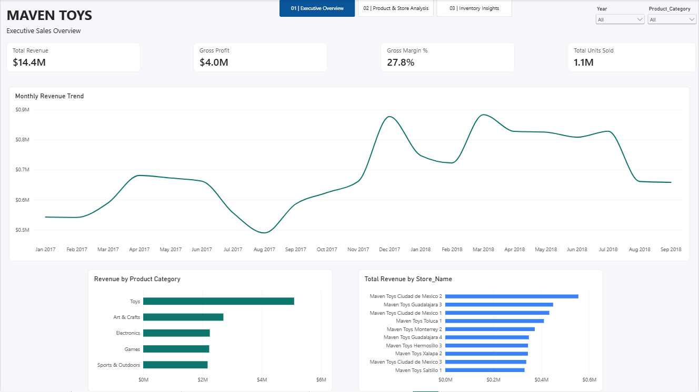

[](https://doi.org/10.5281/zenodo.24056033)

# Maven Toys | Sales & Inventory Analytics

A three-page **Power BI Desktop** portfolio project analyzing sales, product profitability, store performance, and stock availability for Maven Toys, a **fictional** toy retailer in Mexico.



## Dashboard pages

| Page | Questions answered | Preview |
|---|---|---|
| **Executive Overview** | How are revenue, gross profit, margin, and units sold performing over time? Which categories and stores lead? | [View screenshot](screenshots/01-executive-overview.png) |
| **Product & Store Analysis** | Which products and categories generate revenue and gross profit? How does performance vary by store location type? | [View screenshot](screenshots/02-product-store-analysis.png) |
| **Inventory Insights** | How much inventory is held at cost? Which recorded store–product combinations have low or zero stock? | [View screenshot](screenshots/03-inventory-insights.png) |

**Data model:** [View relationship diagram](screenshots/04-data-model.png)  
**Static report:** [View the three-page PDF](Maven_Toys_Dashboard.pdf)  
**Interactive desktop report:** Open [`Maven_Toys_Dashboard.pbix`](Maven_Toys_Dashboard.pbix) in Power BI Desktop.

## Project objectives

- Monitor revenue trends, units sold, and gross profitability.
- Compare product categories, individual products, and store-location types.
- Quantify stock value and highlight potentially at-risk inventory.
- Build an understandable, interactive report using a reusable data model.

## What I built

- Cleaned and typed four CSV tables in **Power Query**: `Sales`, `Products`, `Stores`, and `Inventory`.
- Created a **Calendar** table and five active, single-direction, many-to-one relationships: Calendar→Sales; Products→Sales; Stores→Sales; Products→Inventory; Stores→Inventory.
- Created reusable **DAX measures** for revenue, units, transaction count, cost, gross profit, gross margin, average transaction value, stock units, inventory value, and stock-availability metrics.
- Designed three pages featuring KPI cards, time-series charts, ranked bars, a matrix with conditional formatting, slicers, and page navigation.

## Metric definitions

| Metric | Definition |
|---|---|
| Total Revenue | Sum of units sold × listed product selling price |
| Total Cost | Sum of units sold × listed product cost |
| Gross Profit | Total Revenue − Total Cost (not net profit) |
| Gross Margin % | Gross Profit ÷ Total Revenue |
| Average Transaction Value | Total Revenue ÷ distinct `Sale_ID` count; **per recorded sale**, not necessarily a complete customer basket |
| Inventory Value | Sum of stock on hand × listed unit product cost |
| Out-of-Stock Rate | Inventory rows with zero units ÷ all recorded inventory rows |

## Key findings

1. **Sales:** [Total revenue was $14.4 million, gross margin was 27.8%, and the category with the highest revenue was Toys.]
2. **Product/store performance:** [The top product revenue was Lego Bricks, and the most profitable store location type is Downtown store types.]
3. **Inventory:** [Total inventory value was $300,210 and out-of-stock rate was 4.8%.]

## Dataset and analytical limitations

- **Original source:** [Maven Analytics — Mexico Toy Sales](https://mavenanalytics.io/data-playground/mexico-toy-sales). Maven Analytics labels the dataset **Public Domain**. The dataset describes a fictional retailer; this is not a live business report.
- **Sales period:** 2017–2018. Inventory is a **single stock snapshot** from around **October 1, 2018**, not an inventory time series.
- **Prices and costs:** Revenue and gross-profit calculations use the product-level price/cost values in the supplied data; historical price changes and operating expenses are not represented.
- **Low-stock rule:** 1–10 units per recorded store–product combination is an exploratory threshold, not a validated reorder point.
- **Out-of-stock rate:** Based only on **recorded** inventory combinations. Missing store–product rows are not assumed to be stockouts. No lost sales are inferred from the snapshot.
- **Currency:** USD as represented in the source prices and costs.

## How to open and refresh

1. Install **Power BI Desktop** on Windows.
2. Open `Maven_Toys_Dashboard.pbix` to inspect the existing report.
3. To refresh on another computer, keep the source CSV files in `data/` and update each CSV path in **Home → Transform data → Power Query → Source** to point to your local copies. Select **Close & Apply**, then refresh.
4. If this repository also contains a `.pbip` file, it provides text-based report/model definitions for Git; opening the `.pbip` may require refreshing the model from the CSV sources.

## Repository contents

```text
maven-toys-powerbi/
├── README.md
├── Maven_Toys_Dashboard.pbix
├── Maven_Toys_Dashboard.pdf
├── screenshots/
│   ├── 01-executive-overview.png
│   ├── 02-product-store-analysis.png
│   ├── 03-inventory-insights.png
│   └── 04-data-model.png
├── data/
│   ├── sales.csv
│   ├── products.csv
│   ├── stores.csv
│   └── inventory.csv
└── .gitignore
```

Power BI `.pbip`, `.Report/`, and `.SemanticModel/` files can also be included if saved in PBIP format. These are optional for this portfolio version.

## Tools

**Power BI Desktop** · **Power Query** · **DAX** · **Dimensional modeling** · **GitHub**

## Attribution

Dataset: Maven Analytics, *Mexico Toy Sales* ([source and license](https://mavenanalytics.io/data-playground/mexico-toy-sales)). Power BI report design, calculations, and documentation were created as an independent portfolio exercise.
